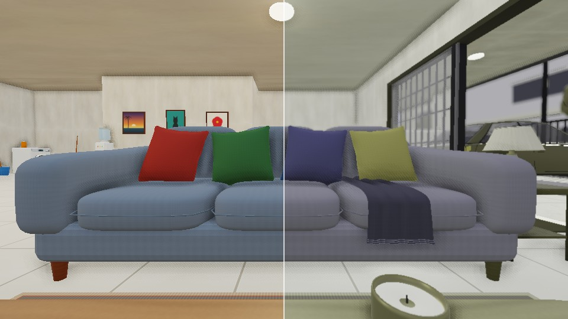
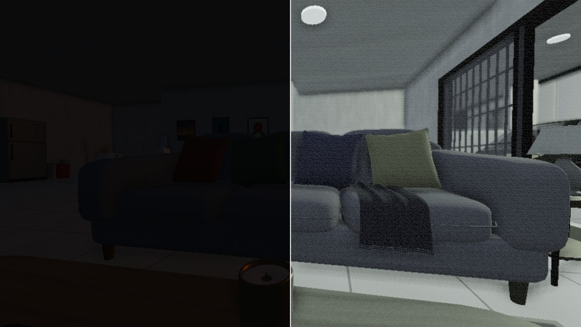

# Cat & Dog Vision Simulator

A static, single-page 3D toy for seeing the world the way a pet does. Walk around a two-storey terrace house as an orange-and-white cat or a Shiba Inu, and switch between their vision and human vision at any time — in **English** or Chinese.

**Live:** https://chengwq95.github.io/cat-dog-vision-simulator/

## Preview

The orange-and-white tabby and Shiba Inu, before and after the model rebuild. Each row shows the same animal from the same camera angle.

The dining room, kitchen sink and bedroom before and after the furniture rebuild, rendered from the same positions in human vision.

**Side by side** — drag the handle: human vision on the left, cat vision on the right. The red and green cushions collapse into a similar yellow-brown for the cat; blue and yellow stay distinct.

| Dog vision, 3rd person | Lights off |
|---|---|
|  |  |

---

## What changes between eyes

| | Human | Cat | Dog |
|---|---|---|---|
| **Colour** | Full colour | Two cone types: red and green merge into yellow-brown | Two cone types, slightly more saturated than a cat |
| **Sharpness** | Sharp | About 1/6 of a human; distance blurs, and so does anything at the nose | About 1/4 of a human; nothing closer than half a metre is in focus |
| **Field of view** | Narrow | Wide (~200°), edges pulled in | Widest (~240°) |
| **Night** | Almost black | Tapetum amplifies faint street and altar light | Brighter than a human, dimmer than a cat |
| **Eye height** | — | About 25 cm | About 50 cm |

## Features

- **Two animals**: pick the cat or the dog on the start screen, or press **Q** any time. The other animal waits where you left it.
- **Real vision shader**, not a CSS filter: the scene is rendered with depth, then a full-screen shader applies dichromatic colour, depth-based blur, wide-angle warp, night gain and grain, and a slight glow on things that move while you hold still.
- **Three views**: 1st person, 3rd person (the camera keeps out of walls and furniture) and **CCTV** — four security cameras with a Malaysia-time timestamp and infrared at night.
- **Compare** mode with a draggable split, **Day / Lights off** and **Rain**.
- **12 to-dos**: knock things off the table, bat the yarn, scratch the sofa, crawl into the box, eat kibble, catch the gecko, ride the robot vacuum, watch the bird from the upstairs windowsill, nap on the bed, survey from the car roof, rub against your owner, greet the passer-by at the gate.
- **People**: your owner chops vegetables in the kitchen during the day (walk up and they bend down to pet you and top up the bowl) and sleeps upstairs at night; a passer-by walks along the street and waves back.
- **Live details**: wall clocks and the LED clock show the real time, and the wall calendar shows today's date.
- **Collision everywhere**: furniture, small objects, stairs and the car all block the body, head and tail, with an automatic way out if you ever get wedged.
- **EN / 中文** interface switch in the top bar. It follows your browser language until you choose, and your choice is saved in your browser (`localStorage`). Add `?lang=en` or `?lang=zh` to a link to open it in a given language.
- **Quality**: **High quality** renders at 2× resolution with sharp shadows; **Smooth** turns shadows off. If the frame rate drops below 40 fps, the page lowers its resolution automatically.

## Controls

| Key | Action |
|---|---|
| **W A S D** | Walk (hold **Shift** to run) |
| **Mouse** | Click the scene, then move the mouse to look around; **Esc** releases |
| **Space** | Jump onto the sofa, table, bed and car roof |
| **E** | Interact with what's in front of you (meow / bark when there's nothing) |
| **Q** | Switch between cat and dog |

## How to use

No install or build step. Open `index.html` in a desktop browser with WebGL, or serve the folder with any static server. Everything is in that one file: the house, animals, people and textures are all generated in code, and sound is made with the Web Audio API. Three.js r128 is loaded from cdnjs, so an internet connection is needed the first time.

Designed for desktop browsers with a keyboard and mouse.

## Deploy to GitHub Pages

1. Repository **Settings → Pages**
2. Source: **Deploy from a branch**, branch `main`, folder `/ (root)`
3. Save and wait 1–2 minutes, then open `https://chengwq95.github.io/cat-dog-vision-simulator/`

## License

[MIT](LICENSE).
