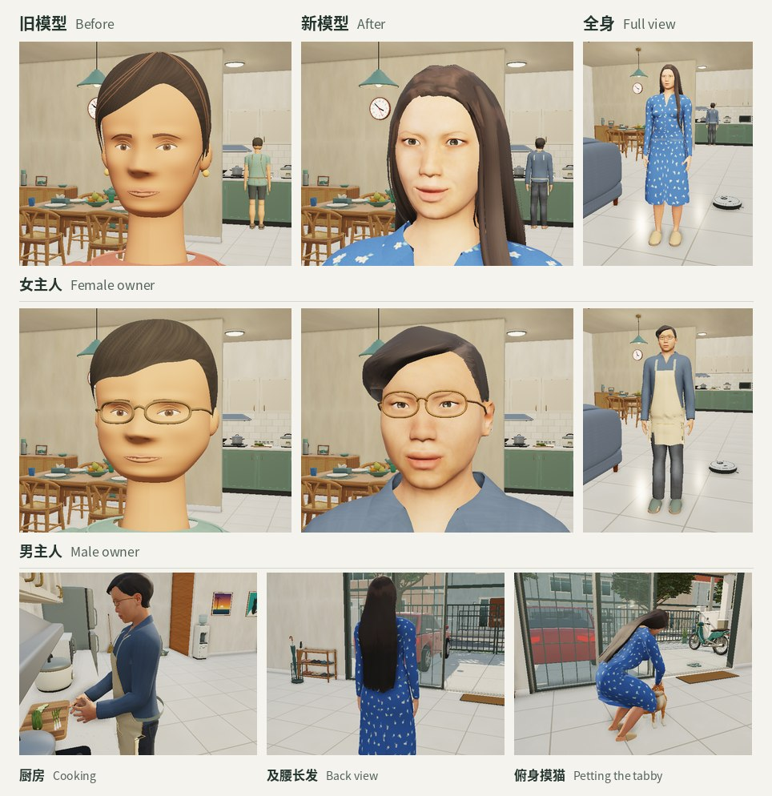
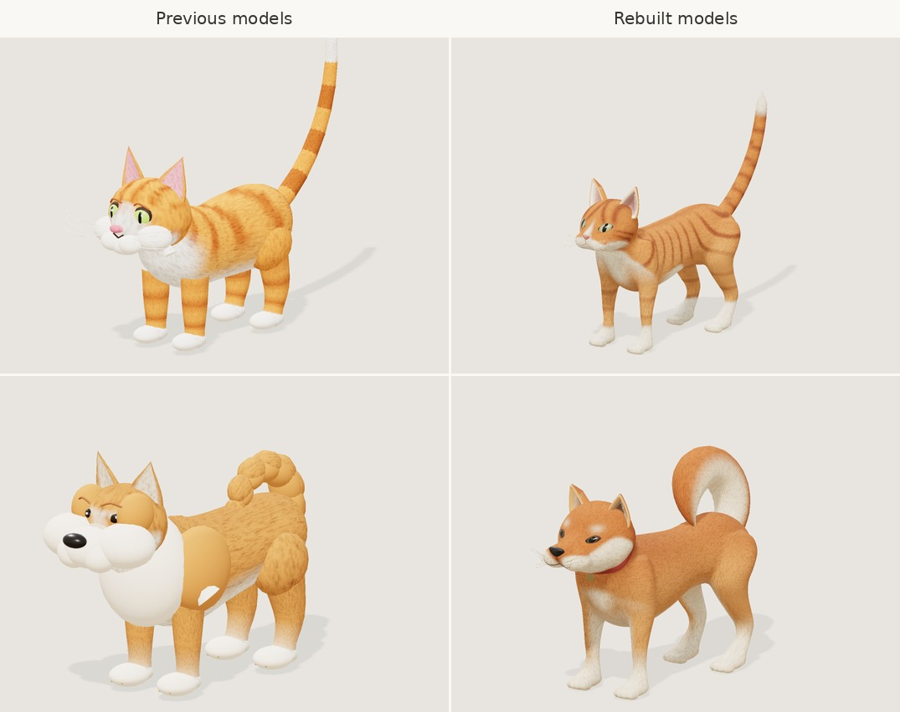
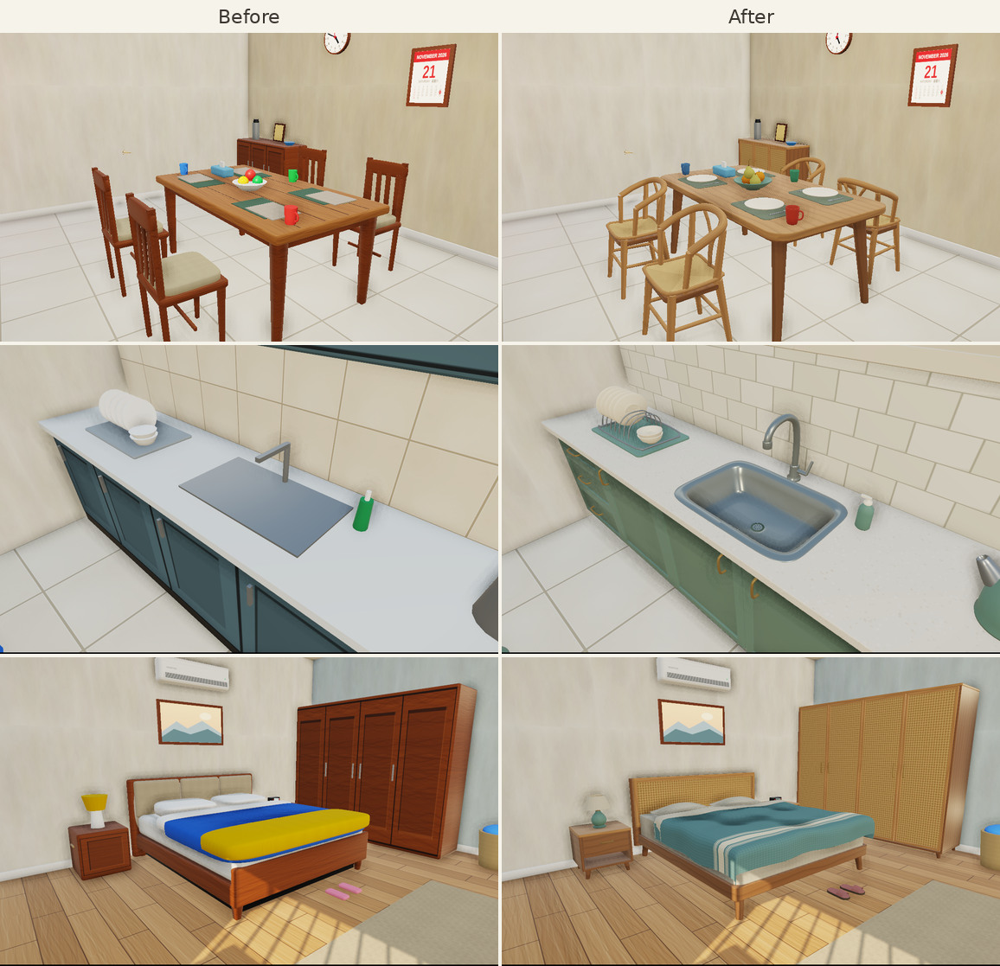
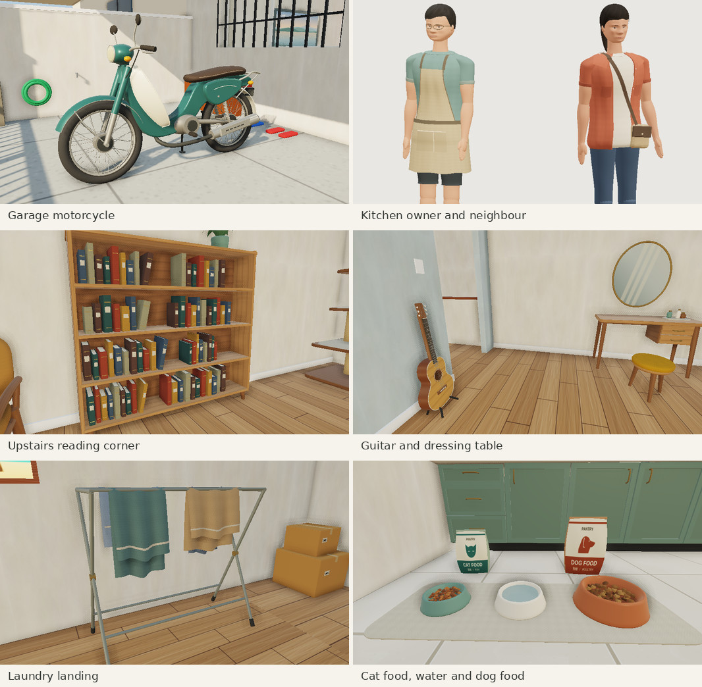
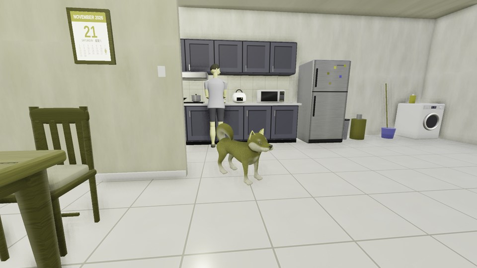

# Cat & Dog Vision Simulator

A static, single-page 3D toy for seeing the world the way a pet does. Explore a two-storey terrace house as an orange-and-white cat, a Shiba Inu or either of their two owners. As a pet you can compare animal and human vision. As an owner you can walk through the same rooms at adult eye height, pet both animals and fill their bowls. The game supports English and Chinese.

**Live:** https://chengwq95.github.io/cat-dog-vision-simulator/

## Preview

The playable owners have contemporary Japanese everyday styling. She wears a blue floral midi dress and has long, dark hair draped over one shoulder. He wears a plain indigo shirt, wire glasses and a cotton apron. The portraits below were taken in the living room from the same camera positions before and after the rebuild.

Choose from four characters on the start screen. On a phone, the complete game title stays visible above the choices and in the toolbar during play. [Compare the mobile screens.](docs/mobile-role-picker.jpg)

The home has a cane console in the hall, a tea trolley beside the dining room, a lounge chair in the living room and a sewing table and linen chest upstairs. [See the original furnishing update.](docs/family-home.jpg)

The orange-and-white tabby and Shiba Inu, before and after the model rebuild. Each row shows the same animal from the same camera angle.

The dining room, kitchen sink and bedroom before and after the furniture rebuild, rendered from the same positions in human vision. [See the dining chair placement from above.](docs/dining-layout.jpg)

The garage motorcycle, the two people, the upstairs rooms and the kitchen feeding station.

The utility area has a bound grass broom, a low-lipped dustpan, a cotton mop with a wringer pail, and a litter tray with a slotted scoop. [Compare the old and new household models from the same positions.](docs/household-tools.jpg)

The porch and upstairs windows look onto a Malaysian terrace street with rain trees, tropical almond trees, tiled roofs and planted verges. The neighbour follows the dips in the pavement at each driveway. [Compare the street, trees and window view.](docs/street-models.jpg)

Indoors, the family shrine has carved woodwork and red votive lamps, the robot vacuum has a rotating side brush, and the ball of yarn rolls with its wound strands. [Compare the plants, living room, study and kitchen details.](docs/house-details.jpg)

The living room TV plays a 16-second wildlife programme during the day. [Watch the egrets and kingfisher sequence.](docs/river-programme.gif)

**Side by side** — drag the handle: human vision on the left, cat vision on the right. The red and green cushions collapse into a similar yellow-brown for the cat; blue and yellow stay distinct.

| Dog vision, 3rd person | Lights off |
|---|---|
|  |  |

---

## What changes between eyes

| | Human | Cat | Dog |
|---|---|---|---|
| **Colour** | Full colour | Two cone types: red and green merge into yellow-brown | Two cone types, slightly more saturated than a cat |
| **Sharpness** | Sharp | About 1/6 of a human; distance blurs, and so does anything at the nose | About 1/4 of a human; nothing closer than half a metre is in focus |
| **Field of view** | Narrow | Wide (~200°), edges pulled in | Widest (~240°) |
| **Night** | Almost black | Tapetum amplifies faint street and altar light | Brighter than a human, dimmer than a cat |
| **Eye height** | About 1.5 m when playing as an owner | About 25 cm | About 50 cm |

## Features

- **Four playable characters.** Choose the cat, dog, female owner or male owner at the start. Use **R** to choose again. Each character stays where you leave them during the session.
- **Real vision shader**, not a CSS filter: the scene is rendered with depth, then a full-screen shader applies dichromatic colour, depth-based blur, wide-angle warp, night gain and grain, and a slight glow on things that move while you hold still.
- **Three views**: 1st person, 3rd person (the camera keeps out of walls and furniture) and **CCTV** — four security cameras with a Malaysia-time timestamp and infrared at night.
- **Compare** mode with a draggable split, **Day / Lights off** and **Rain**.
- **12 pet to-dos**: knock things off the table, bat the yarn, scratch the sofa, crawl into the box, eat kibble, catch the gecko, ride the robot vacuum, watch the bird from the upstairs windowsill, nap on the bed, survey from the car roof, rub against your owner, greet the passer-by at the gate.
- **Feeding** — the cat eats from the shallow green bowl and the dog from the larger terracotta bowl, with water between them. Each animal has its own portions and meal to-do. Press **E** near your bowl to eat. Nuzzle either owner for a refill or switch to an owner and top up the bowl yourself.
- **Playable owners.** The male owner cooks in the kitchen and sleeps upstairs at night. The female owner reads a pattern book near the stairs and visits the upstairs sewing corner in the evening. Take control of either to explore or finish five household tasks together. Pet the cat and dog, tend to their two bowls and greet the other owner. Outside, the neighbour still walks along the street and waves at the pets.
- **Live details** — the living room TV alternates between egrets in flight and a kingfisher diving from its perch. Switching the lights off pauses the programme. The standing fan oscillates upstairs, the clocks show the time and the wall calendar shows today's date.
- **Collision everywhere**: furniture, small objects, stairs and the car all block the body, head and tail, with an automatic way out if you ever get wedged.
- **EN / 中文** interface switch in the top bar. It follows your browser language until you choose, and your choice is saved in your browser (`localStorage`). Add `?lang=en` or `?lang=zh` to a link to open it in a given language.
- **Quality**: **High quality** renders at 2× resolution with sharp shadows; **Smooth** turns shadows off. If the frame rate drops below 40 fps, the page lowers its resolution automatically.

## Controls

| Key | Action |
|---|---|
| **W A S D** | Walk (hold **Shift** to run) |
| **Mouse** | Click the scene, then move the mouse to look around; **Esc** releases |
| **Space** | Jump as a pet or take a small hop as an owner |
| **E** | Use the nearby interaction. Pets can also meow or bark |
| **Q** | Switch between the two pets or the two owners |
| **R** | Open the four-character picker |

On a touchscreen, use the left stick to walk or push it to the edge to run. Swipe the scene with another finger to look around. Tap ⤴ to jump. Tap 🐾 as a pet or ✋ as an owner to interact. Open **Settings → Character** to choose another character. Settings also contains the camera and vision controls. In Compare mode, drag the round handle to move the divider.

## How to use

Open the live site in a phone or desktop browser with WebGL, or serve the repository with any static server. On desktop you can also open `index.html` directly with the `assets` folder alongside it. The page generates the house and the pets in Three.js and the sound with the Web Audio API. The two owners and their textures are bundled under `assets`. Three.js r128 loads from cdnjs on first use.

## Deploy to GitHub Pages

1. Repository **Settings → Pages**
2. Source: **Deploy from a branch**, branch `main`, folder `/ (root)`
3. Save and wait 1–2 minutes, then open `https://chengwq95.github.io/cat-dog-vision-simulator/`

## License

The game code is available under the [MIT license](LICENSE). The character source art and bundled libraries have their own [credits and license notices](assets/CREDITS.md).
